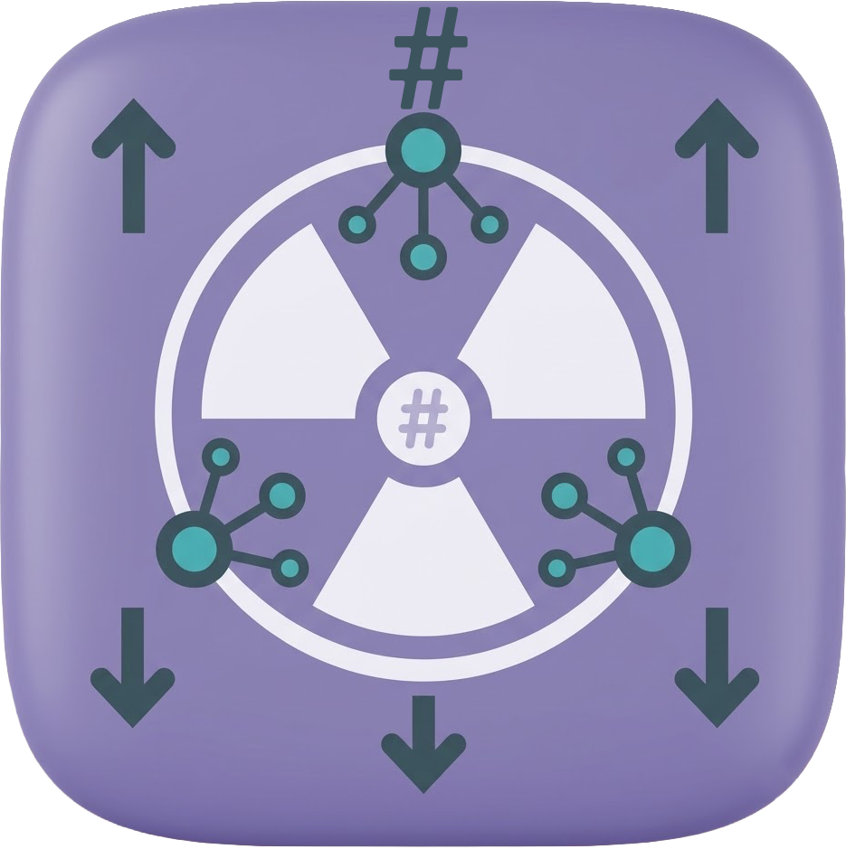

# CS-Ray

<p align="center"></p>

CS-Ray is a proxy client for Windows that I wrote fully in C#. There is no xray.exe or sing-box inside it. The protocols, the TLS, the TUN network stack, all of it is managed .NET code.

That is the whole point of it. It runs on old ARM32 Windows like Windows RT 8.1 (Surface RT, Surface 2), where you can't run v2rayN or the other clients because they need x86 or x64 binaries. It runs fine on normal x86 and x64 Windows too.

I made it for my own Surface RT. I wanted to use my servers on it and nothing worked.

## What it can do

Protocols:

- VLESS over tcp, WebSocket and XHTTP, with TLS or REALITY, and XTLS Vision
- VMess (AEAD) over tcp, WebSocket, the HTTP header camouflage and XHTTP, with or without TLS
- Shadowsocks with the AEAD ciphers (aes-128-gcm, aes-256-gcm, chacha20-ietf-poly1305)
- a SOCKS5, HTTP or HTTPS proxy as the server

Other stuff:

- a local SOCKS5 and HTTP proxy on `127.0.0.1:10810` that any app can use
- two modes on top of that: system proxy, or full tunnel (TUN) that takes all the traffic of the PC, with DNS that doesn't leak
- UDP over VLESS and VMess
- subscriptions: normal base64 link lists, Clash YAML and sing-box JSON
- delay test for your servers
- share a server or a subscription with a link or a QR code (right click it, then Share)
- light and dark theme, and it looks right on high DPI screens

Links it can't run yet (Trojan, Hysteria, TUIC, gRPC and a few more) still get imported. They show up greyed out with the reason, so you know why.

## Download and install

Get the latest version from the [Releases](https://github.com/hamed7ir/CS-Ray/releases) page. There are two files:

- `CS-Ray-Setup-2.0.0.exe` is the installer. It's one exe, just run it. It installs only for your user (to `%LocalAppData%\Programs\CS-Ray`) and doesn't need admin. The same file works on ARM32 and on x86/x64.
- `CS-Ray-2.0.0-portable.zip` if you don't want to install anything. Extract it to a folder and run `CS-Ray.exe`. The portable one keeps its settings in that folder.

You need .NET Framework 4.7 or newer. Windows 10 and 11 already have it. If you're not sure, the installer has a "Check requirements" button.

Where it runs:

- Windows 10 on ARM32 (build 15035). This is the main target.
- Windows RT 8.1, jailbroken. RT only runs desktop apps that Microsoft signed.
- Windows RT 8.0, jailbroken too, but it needs the .NET Framework 4.8 update, and that one is hard to find for RT 8.0 right now.
- normal x86 and x64 Windows, 7 and newer

Your servers and settings are saved in `Documents\CS-Ray\profiles.json`. Uninstalling doesn't delete them.

## Full tunnel mode

When you start the full tunnel, Windows asks for admin (UAC) because CS-Ray has to create a network adapter (Wintun). The system proxy mode never needs admin.

If you use the full tunnel, close CS-Ray from the tray icon (Exit) and don't kill it. Then it can remove the adapter and the routes properly.

## Build it yourself

You need Visual Studio 2017 or newer, or just the Build Tools, with the .NET Framework 4.7 targeting pack.

```
nuget restore CS-Ray.sln
msbuild CS-Ray.sln /t:Build /p:Configuration=Release
```

To make the installer, the portable zip and the checksums like the ones in the releases, run `.\scripts\build.ps1`. There is more about it in [installer/INSTALLER.md](installer/INSTALLER.md).

## Privacy

CS-Ray doesn't collect anything and has no telemetry. It only connects to the servers and subscription links you add.

If you find a leak or any other security problem, please read [SECURITY.md](SECURITY.md) and report it privately.

## Thanks

- [Xray-core](https://github.com/XTLS/Xray-core). I read its source a lot to get the protocols right, and I test CS-Ray against the real xray binary. No Xray code is included in CS-Ray.
- [Wintun](https://www.wintun.net/) for the TUN driver.
- [Bouncy Castle](https://www.bouncycastle.org/) for the crypto.
- [QRCoder](https://github.com/Shane32/QRCoder) for the QR codes.

## License

GPL-3.0. See [LICENSE](LICENSE) and [THIRD-PARTY-NOTICES.md](THIRD-PARTY-NOTICES.md).
